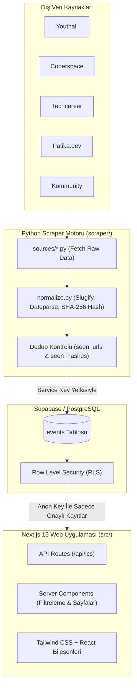

<div align="center">

# 🚀 Fırsat Hub

**Öğrenciler ve yeni mezunlar için staj, hackathon, bootcamp, yarışma ve teknoloji etkinliklerini tek merkezde toplayan açık kaynaklı platform.**

[](https://nextjs.org/)
[](https://react.dev/)
[](https://www.typescriptlang.org/)
[](https://tailwindcss.com/)
[](https://supabase.com/)
[](https://www.python.org/)
[](LICENSE)

[Özellikler](#-öne-çıkan-özellikler) • [Teknoloji Yığını](#-teknoloji-yığını) • [Sıfırdan Kurulum Rehberi](#-sıfırdan-başlayanlar-i̇çin-yerel-kurulum-rehberi) • [Scraper Mimarisi](#-scraper-mimarisi-ve-kaynaklar) • [Sorun Giderme](#-sık-karşılaşılan-sorunlar-ve-çözümleri)

</div>

---

## 📌 Proje Hakkında

Öğrenciler ve kariyerinin başındaki yazılımcılar; staj ilanlarını, hackathonları, ücretsiz bootcamp'leri ve sektörel yarışmaları takip etmek için onlarca farklı platformu tek tek gezmek zorunda kalıyor. Birçok fırsat ise başvuru süresi dolduktan sonra fark ediliyor.

**Fırsat Hub**, popüler kariyer ve etkinlik platformlarını otomatik olarak tarayan (web scraping), verileri tekilleştirip standartlaştıran ve modern bir kullanıcı arayüzü ile öğrencilere sunan bir ekosistemdir. Kullanıcılar başvuru tarihine göre sıralanmış fırsatları filtreleyebilir ve son başvuru tarihlerini **tek tıkla Google Takvim veya Apple/Outlook (.ics)** takvimlerine kaydedebilirler.

---

## ✨ Öne Çıkan Özellikler

- **🤖 Otomatik Veri Kazıma (ETL Pipeline):** Python tabanlı modüler scraper sistemi; Youthall, Coderspace, Techcareer, Patika.dev ve Kommunity gibi platformlardan güncel verileri otomatik olarak çeker.
- **🛡️ Çift Katmanlı Dedup & Hash Koruması:** Hem özgün URL hem de başlık/açıklama tabanlı SHA-256 içerik özeti (content hash) kullanılarak mükerrer kayıtlar %100 engellenir.
- **🎯 Çok Yönlü Filtreleme:** Kategoriye (Staj, Hackathon, Bootcamp, Yarışma, Konferans), eğitim seviyesine (Lise, Lisans, Yüksek Lisans) ve anahtar kelimelere göre anlık arama.
- **📅 Tek Tıkla Takvim Entegrasyonu:** Etkinlik detayından veya kartlardan Google Calendar'a etkinlik ekleme veya RFC-5545 uyumlu `.ics` dosyası indirme.
- **⚡ Yüksek Performanslı Web Arayüzü:** Next.js 15 App Router ve React 19 Server Components ile sıfıra yakın istemci yükü, hızlı sayfa açılışları ve SEO uyumluluğu.
- **🔒 Güvenli Veritabanı Mimarisi:** Supabase PostgreSQL üzerinde Row Level Security (RLS) politikaları; halka açık sadece okuma (approved) yetkisi, veri kazıyıcı için ise güvenli `service_role` yetkilendirmesi.

---

## 🛠 Teknoloji Yığını

| Alan | Teknoloji | Açıklama |
| :--- | :--- | :--- |
| **Frontend Framework** | **Next.js 15 (App Router)** | Hibrit sunucu ve istemci bileşenleri mimarisi |
| **Kullanıcı Arayüzü** | **React 19 & Tailwind CSS** | Modern, responsive ve erişilebilir arayüz tasarımı |
| **Tip Güvenliği** | **TypeScript 5** | Baştan sona tip kontrollü kod tabanı |
| **Veritabanı & Backend** | **Supabase (PostgreSQL 15+)** | RLS, `pgcrypto`, `pg_trgm` (trigram full-text search) |
| **Scraper & Bot** | **Python 3.10+** | Modüler kaynak tarama motoru |
| **Ayrıştırma & HTTP** | **BeautifulSoup4 & Requests** | HTML ayrıştırma ve REST API istemcisi |
| **Tarih & Metin İşleme** | **Dateparser & Python-Slugify** | Türkçe doğal dil tarih dönüştürme ve SEO dostu URL slug üretimi |

---

## 🏗 Sistem Mimarisi



---

## 💻 Sıfırdan Başlayanlar İçin Yerel Kurulum Rehberi

Bu bölüm, bilgisayarında daha önce hiç Node.js veya Python projesi çalıştırmamış birinin bile adım adım projeyi ayağa kaldırabilmesi için özel olarak hazırlanmıştır.

### 📋 1. Ön Gereksinimlerin Hazırlanması

Projeyi çalıştırmadan önce bilgisayarınızda şu 3 temel aracın kurulu olması gerekir:

1. **Node.js (v18.x veya v20 LTS önerilir):**
   - [nodejs.org](https://nodejs.org/) adresine gidin ve **LTS (Recommended for Most Users)** sürümünü indirip kurun.
   - Kurulumu test etmek için bir terminal (PowerShell veya CMD) açıp şu komutları yazın:
     ```bash
     node -v
     npm -v
     ```
     *(Ekrana `v20.x.x` gibi bir sürüm numarası gelmelidir.)*

2. **Python (3.10 veya üzeri):**
   - [python.org/downloads](https://www.python.org/downloads/) adresine gidin ve en güncel sürümü indirin.
   - ⚠️ **ÇOK ÖNEMLİ:** Kurulum sihirbazının ilk ekranında en altta yer alan **"Add python.exe to PATH"** seçeneğini mutlaka işaretleyin!
   - Kurulumu test etmek için:
     ```bash
     python --version
     pip --version
     ```

3. **Git (Versiyon Kontrol Sistemi):**
   - [git-scm.com](https://git-scm.com/) adresinden kurabilirsiniz.
   - Test için: `git --version`

---

### 📥 2. Projeyi Bilgisayarınıza İndirin

Terminali veya PowerShell'i açın ve projeyi klonlamak istediğiniz dizine giderek şu komutları çalıştırın:

```bash
# Projeyi GitHub'dan bilgisayarınıza çekin
git clone https://github.com/musabak10/firsat-hub.git

# Proje dizinine giriş yapın
cd firsat-hub
```

---

### 🗄️ 3. Supabase Veritabanını Kurun

Proje, veritabanı olarak bulut tabanlı PostgreSQL sağlayan **Supabase** platformunu kullanır.

1. [supabase.com](https://supabase.com/) adresine gidip ücretsiz bir hesap oluşturun.
2. Dashboard üzerinden **"New Project"** butonuna tıklayın, bir proje adı ve şifre belirleyip projenizi oluşturun (1-2 dakika sürer).
3. Sol menüden **SQL Editor** (`>_` simgesi) sekmesine gidin.
4. **"New Query"** butonuna tıklayın.
5. Projenizdeki [`supabase/schema.sql`](supabase/schema.sql) dosyasının tüm içeriğini kopyalayıp buradaki editöre yapıştırın ve sağ alttaki yeşil **Run** butonuna basın.
   > Bu işlem; `events` tablosunu, arama indekslerini ve okuma/yazma güvenlik kurallarını (RLS) otomatik olarak oluşturur.
6. Sol menünün en altındaki dişli simgesine (**Project Settings**) tıklayın ve **API** menüsüne gelin:
   - **Project URL:** Proje URL adresiniz.
   - **Project API Keys > anon (public):** Genel okuma anahtarı.
   - **Project API Keys > service_role (secret):** Scraper'ın veritabanına doğrudan kayıt ekleyebilmesi için gerekli gizli yönetici anahtarı.

---

### 🔑 4. Çevre Değişkenlerini (`.env.local`) Yapılandırın

Proje ana dizininde bulunan `.env.example` dosyasının bir kopyasını oluşturup adını `.env.local` yapın:

**Windows PowerShell için:**
```powershell
Copy-Item .env.example .env.local
```

**macOS / Linux için:**
```bash
cp .env.example .env.local
```

Şimdi `.env.local` dosyasını VS Code veya herhangi bir metin editörü ile açın ve Supabase'den aldığınız değerlerle doldurun:

```env
# Web Uygulaması İçin Supabase Ayarları
NEXT_PUBLIC_SUPABASE_URL=https://projeniz.supabase.co
NEXT_PUBLIC_SUPABASE_ANON_KEY=anon-public-anahtariniz
NEXT_PUBLIC_SITE_URL=http://localhost:3000

# Scraper Ayarları (Supabase Settings > API > service_role anahtarı)
SUPABASE_URL=https://projeniz.supabase.co
SUPABASE_SERVICE_KEY=service_role-gizli-anahtariniz
AUTO_APPROVE=1

# İletişim / Bot E-postası
BOT_CONTACT_EMAIL=ornek@domain.com
```

> 💡 **İpucu:** `SUPABASE_SERVICE_KEY` alanını boş bıraksanız bile scraper **Test / Önizleme Modunda** çalışır ve bulunan fırsatları konsola listeler. Ancak veritabanına kalıcı kayıt yazmak için bu anahtar gereklidir.

---

### 🌐 5. Web Uygulamasını (Next.js) Çalıştırma

Gereksinimler ve ortam değişkenleri hazır olduktan sonra web arayüzünü ayağa kaldıralım:

```bash
# 1. Node.js paket bağımlılıklarını indirin
npm install

# 2. Yerel geliştirme sunucusunu başlatın
npm run dev
```

Terminalde şu çıktıyı gördüğünüzde uygulama hazır demektir:
```text
▲ Next.js 15.1.0
- Local: http://localhost:3000
```

Tarayıcınızı açın ve [http://localhost:3000](http://localhost:3000) adresine gidin. Fırsat Hub web arayüzü karşınızda! 🎉

---

### 🕷️ 6. Python Scraper'ı (Veri Toplayıcıyı) Çalıştırma

Web arayüzünde görüntülenecek etkinlikleri internetteki kaynaklardan çekmek için Python scraper motorunu çalıştıracağız.

Yeni bir terminal penceresi açın (Next.js çalışmaya devam etsin) ve proje ana dizininde olduğunuzdan emin olun.

#### Adım 6.1: Sanal Ortam (Virtual Environment) Oluşturma

Python paketlerinin bilgisayarınızdaki diğer projelerle çakışmaması için projeye özel bir izole ortam oluşturuyoruz:

```bash
python -m venv .venv
```

#### Adım 6.2: Sanal Ortamı Aktifleştirme

İşletim sisteminize uygun olan komutu çalıştırın:

- **Windows PowerShell:**
  ```powershell
  .\.venv\Scripts\Activate.ps1
  ```
  *(Terminal satırının başında `(.venv)` ibaresi belirmelidir.)*

  > ⚠️ **Windows'ta "Script çalıştırma kısıtlandı" (ExecutionPolicy) hatası alırsanız:**
  > PowerShell'i kapatıp normal şekilde şu komutu bir defa çalıştırmanız yeterlidir:
  > ```powershell
  > Set-ExecutionPolicy -ExecutionPolicy RemoteSigned -Scope CurrentUser
  > ```
  > Ardından tekrar `.\.venv\Scripts\Activate.ps1` komutunu çalıştırabilirsiniz.

- **Windows Komut İstemi (CMD):**
  ```cmd
  .\.venv\Scripts\activate.bat
  ```

- **macOS / Linux:**
  ```bash
  source .venv/bin/activate
  ```

#### Adım 6.3: Python Kütüphanelerini Yükleme

```bash
pip install -r scraper/requirements.txt
```

#### Adım 6.4: Scraper'ı Başlatma

```bash
python scraper/main.py
```

Scraper çalıştığında konsolda tüm kaynaklar taranacak ve bulunan etkinlikler ekrana yansıtılacaktır:

```text
--> [Youthall] taranıyor...
  [OK] Youthall: 14 bulundu, 14 veritabanına eklendi.
--> [Coderspace] taranıyor...
  [OK] Coderspace: 8 bulundu, 8 veritabanına eklendi.
--> [Techcareer] taranıyor...
  [OK] Techcareer: 6 bulundu, 6 veritabanına eklendi.
--> [Patika] taranıyor...
  [OK] Patika: 5 bulundu, 5 veritabanına eklendi.

[TAMAMLANDI] Toplam 33 fırsat tarandı, 33 yeni kayıt tespit edildi.
```

Tarayıcınızdaki [http://localhost:3000](http://localhost:3000) sayfasını yenilediğinizde, çekilen etkinliklerin hemen listelendiğini görebilirsiniz!

---

### ⚡ VS Code Kullanıcıları İçin Kolay Çalıştırma

Projeyi **Visual Studio Code** ile açtıysanız `.vscode` klasöründeki konfigürasyonlar sizin için önceden ayarlanmıştır:

1. VS Code'da klavyeden **`F5`** tuşuna basın.
2. Veya sol çubuktan **"Çalıştır ve Hata Ayıkla" (Run and Debug)** sekmesine gidip **"Python: Scraper Çalıştır (main.py)"** seçeneğini başlatın.
3. Veya doğrudan `scraper/main.py` dosyasını açıp sağ üst köşedeki **"Run Python File" (Oynat)** butonuna tıklayın.

---

## 📂 Proje Dizin Yapısı

```text
firsat-hub/
├── .vscode/                 # VS Code otomatik debug ve Python interpreter ayarları
│   ├── launch.json          # F5 ile tek tıkla çalıştırma profilleri
│   └── settings.json        # Python yol ve analiz ayarları
├── scraper/                 # Python tabanlı veri kazıma (scraper) motoru
│   ├── sources/             # Kaynak bazlı modüller
│   │   ├── base.py          # Soyut BaseSource sınıfı ve rate limiting
│   │   ├── youthall.py      # Youthall etkinlik ve staj kazıyıcısı
│   │   ├── coderspace.py    # Coderspace bootcamp & etkinlik kazıyıcısı
│   │   ├── techcareer.py    # Techcareer etkinlik kazıyıcısı
│   │   ├── patika.py        # Patika.dev bootcamp kazıyıcısı
│   │   └── kommunity.py     # Topluluk etkinlikleri kazıyıcısı
│   ├── main.py              # Scraper ana çalıştırma dosyası & DB yükleyici
│   ├── normalize.py         # Metin temizleme, tarih ayrıştırma, hash üretimi
│   └── requirements.txt     # Python kütüphane listesi
├── src/                     # Next.js 15 Web Uygulaması kaynak kodları
│   ├── app/                 # App Router sayfaları ve API rotaları
│   │   ├── api/ics/         # RFC-5545 uyumlu takvim dosyası üreten endpoint
│   │   ├── etkinlik/[slug]/ # Etkinlik detay sayfası (SSR & Meta tagler)
│   │   ├── globals.css      # Genel CSS ve Tailwind stilleri
│   │   ├── layout.tsx       # Ana sayfa iskeleti, header ve footer
│   │   ├── not-found.tsx    # 404 Hata sayfası
│   │   └── page.tsx         # Ana sayfa (Filtreli etkinlik listesi)
│   ├── components/          # Tekrar kullanılabilir React bileşenleri
│   │   ├── CalendarButtons  # Google Calendar ve iCal indirme butonları
│   │   ├── DeadlineBadge    # Kalan gün sayacı ve durum rozetleri
│   │   ├── EventCard        # Etkinlik kartı bileşeni
│   │   └── FilterBar        # Arama ve kategori filtreleme çubuğu
│   └── lib/                 # Yardımcı fonksiyonlar ve servisler
│       ├── calendar.ts      # iCal / Google Takvim URL oluşturucuları
│       ├── events.ts        # Supabase sorguları ve filtreleme mantığı
│       ├── supabase.ts      # Supabase istemci başlatıcı
│       └── types.ts         # TypeScript veri tipleri ve sabitler
├── supabase/                # Veritabanı şemaları
│   └── schema.sql           # Tablolar, indeksler ve RLS güvenlik kuralları
├── .env.example             # Örnek çevre değişkenleri şablonu
├── package.json             # Node.js bağımlılıkları ve npm komutları
├── tailwind.config.ts       # Tailwind CSS tasarım sistemi ayarları
└── tsconfig.json            # TypeScript yapılandırması
```

---

## 📡 Scraper Mimarisi ve Kaynaklar

Her kaynak modülü [`scraper/sources/base.py`](scraper/sources/base.py) dosyasındaki `BaseSource` sınıfından türer.

| Kaynak | Alan Adı | Taranan İçerik Türleri | Yöntem |
| :--- | :--- | :--- | :--- |
| **Youthall** | `youthall.com` | Zirveler, Hackathonlar, Staj Programları, Yarışmalar | HTML Ayrıştırma (BS4) |
| **Coderspace** | `coderspace.io` | Bootcamp'ler, Datathonlar, Hiring Challenge'lar | HTML Ayrıştırma (BS4) |
| **Techcareer** | `techcareer.net` | Bootcamp, Workshop, Teknoloji Kulüpleri | JSON / HTML Ayrıştırma |
| **Patika.dev** | `patika.dev` | Kurumsal Bootcamp'ler, Burs Programları | Web Scraping & API |
| **Kommunity** | `kommunity.com` | Topluluk Buluşmaları ve Webinar'lar | Keşif ve Etkinlik Listeleri |

### Yeni Bir Kaynak Nasıl Eklenir?

Yeni bir platform eklemek son derece kolaydır:
1. `scraper/sources/` klasöründe yeni bir dosya oluşturun (örn: `kariyer.py`).
2. `BaseSource` sınıfını miras alan sınıfınızı tanımlayın ve `fetch()` metodunu uygulayın:
   ```python
   from .base import BaseSource

   class KariyerSource(BaseSource):
       name = "KariyerNet"

       def fetch(self) -> list[dict]:
           # İlgili sayfayı çekin ve standart dict formatında döndürün
           return [{
               "title": "Örnek Staj Programı",
               "organization": "Örnek Şirket",
               "application_url": "https://...",
               "category": "staj",
               "education_levels": ["lisans"],
               "deadline": "2026-11-01",
               "is_online": True,
               "location": "İstanbul"
           }]
   ```
3. `scraper/main.py` dosyasındaki `SOURCES` listesine bu sınıfın örneğini ekleyin.

---

## ❓ Sık Karşılaşılan Sorunlar ve Çözümleri

### 1. `python` veya `pip` komutu çalışmıyor / Windows Mağazası açılıyor
- **Neden:** Python kurulurken "Add python.exe to PATH" seçeneği işaretlenmemiştir.
- **Çözüm:** Python yükleyicisini tekrar çalıştırıp **Modify > Next** adımlarından **"Add Python to environment variables"** seçeneğini işaretleyin. Veya Windows Arama Çubuğuna *"Uygulama yürütme diğer adları"* yazıp `python.exe` ve `python3.exe` yönlendirmelerini kapatın.

### 2. PowerShell'de `Activate.ps1 cannot be loaded because running scripts is disabled` hatası
- **Neden:** Windows PowerShell'in varsayılan güvenlik ilkesi harici script çalıştırmayı engeller.
- **Çözüm:** PowerShell'de şu komutu çalıştırın:
  ```powershell
  Set-ExecutionPolicy -ExecutionPolicy RemoteSigned -Scope CurrentUser
  ```

### 3. `Supabase RLS Hatası (Row-level security policy violation)`
- **Neden:** Scraper çalışırken `.env.local` dosyasındaki `SUPABASE_SERVICE_KEY` tanımsızdır veya `anon` anahtarı yazılmıştır.
- **Çözüm:** Supabase panelinde **Project Settings > API** bölümüne gidin. `service_role` (secret) anahtarını kopyalayıp `.env.local` dosyasındaki `SUPABASE_SERVICE_KEY=` karşısına yapıştırın.

### 4. `Port 3000 is already in use` (Port 3000 kullanımda)
- **Neden:** Bilgisayarınızda arka planda başka bir Next.js veya Node.js süreci açıktır.
- **Çözüm:** Next.js'i farklı bir portta başlatabilirsiniz:
  ```bash
  npx next dev -p 3001
  ```

### 5. `ModuleNotFoundError: No module named 'supabase'`
- **Neden:** Python kütüphaneleri sanal ortam aktif değilken kurulmuş veya hiç kurulmamıştır.
- **Çözüm:** Terminalde `(.venv)` ibaresini gördüğünüzden emin olun ve tekrar şu komutu çalıştırın:
  ```bash
  pip install -r scraper/requirements.txt
  ```

---

## 🤝 Katkıda Bulunma (Contributing)

Topluluk katkılarını memnuniyetle karşılıyoruz! Katkıda bulunmak için:

1. Bu depoyu (repository) Fork'layın.
2. Yeni bir özellik veya düzeltme için branch açın (`git checkout -b ozellik/yeni-kaynak`).
3. Değişikliklerinizi commit edin (`git commit -m 'feat: Yeni kaynak eklendi'`).
4. Branch'inizi push edin (`git push origin ozellik/yeni-kaynak`).
5. Bir **Pull Request (PR)** açın.

---

## 📄 Lisans

Bu proje [MIT Lisansı](LICENSE) kapsamında lisanslanmıştır. Açık kaynak standartlarına uygun şekilde özgürce kullanılabilir, geliştirilebilir ve dağıtılabilir.

---

## 📬 İletişim & Geri Bildirim

Her türlü soru, öneri, hata bildirimi veya iş birliği için:

- **Geliştirici:** Musab Akten
- **E-posta:** [musabakten070@gmail.com](mailto:musabakten070@gmail.com)
- **GitHub:** [@musabak10](https://github.com/musabak10)
